<h1 align="center"> Hello there 👋, I'm Alex </h1>
<h3 align="center"> I'm a Machine Learning Engineer and I love to learn about AI, Data, Software Engineering or Science in general. </h3>

- 🧑‍💻 I'm currently working at Lalilo 🖥️, using AI and data to help children learning to read.
- 🔭 I’m practicing developing: **AI models and apps**.
- 🌱 I’m currently learning Japanese, yes I'm not only coding stuff.

- 🌐 My portfolio: [alexandre-cruel.github.io/portfolio](https://alexandre-cruel.github.io/portfolio/)

- 📫 How to reach me:  
   

- ⚡ Fun facts:  
  Marathons : New York City 2️⃣0️⃣1️⃣9️⃣, Paris 2️⃣0️⃣2️⃣5️⃣.  
  🏜️ MDS120 Morocco 2️⃣0️⃣2️⃣6️⃣ (120km in the Moroccan desert).  
  🏋️ CrossFit & Gym enthusiast.  
  I love skiing, scuba-diving and hiking 🏔️.  
  I play the saxophone 🎷, have a pilot licence 🛩️ and enjoy art 🎨.
   

<h3 align="left">Languages and Tools:</h3>

 
 
 
 
 

 

 

 
 

## My GitHub Stats 📊

 
 
